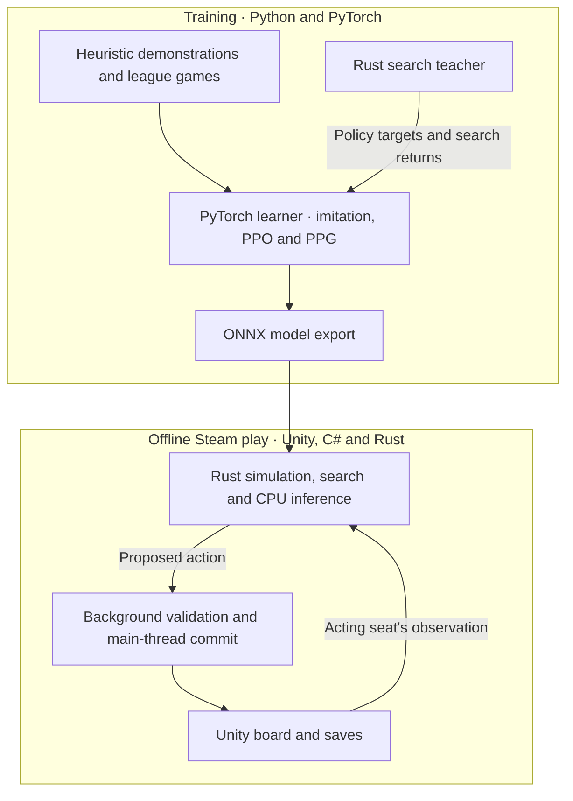

# Brass: Birmingham AI

**A four-player AI for *Brass: Birmingham*, from PyTorch self-play to offline play in the Windows Steam game.**

*Brass: Birmingham* is an economic strategy game where players plan two-action turns around private cards, shared resources, and changing turn order. This project trains a policy and value network in PyTorch, then exports it to ONNX so a Rust search worker can plan moves on the CPU for the Unity game.

[Try the search demo](#getting-started) · [Architecture](#architecture) · [Technical highlights](#technical-highlights) · [Training and evaluation](#training) · [Local play](#local-play) · [Repository guide](#repository-guide)

## Architecture



## Technical highlights

- **Rules and observations.** The Rust simulator resolves staged actions, resource payments, card draws, liquidation, and Canal and Rail scoring. The search worker receives the acting player's hand and recall along with public state. It samples unknown hands and deck order from the remaining card pool. [Rust state and rules](native/brass-ai-core/src/state/) · [Observation contract](configs/contracts/rust-backend/permitted-observation-v1.md)
- **Multiplayer search.** Gumbel information-set Monte Carlo tree search (IS-MCTS) evaluates simulated players from their own observations. Sequential halving narrows the root candidates as simulations finish, and each backup carries a value for all four seats. Both actions in a turn share a search budget. [Search contract](configs/contracts/rust-backend/gumbel-search-v1.md)
- **Neural policy and critic.** The v11.2 network combines a 512-wide, eight-block residual trunk with features for the board entities involved in each action. A shared scorer handles variable sets of legal actions. The critic predicts win share, placement, victory points, and remaining utility for every seat, with optional opponent descriptors. [Model design](ai-research/OPPONENT_CRITIC_DESCRIPTORS_REPORT.md)
- **CPU play in Unity.** A Rust worker runs two single-threaded search sessions with ONNX Runtime. C# checks the proposed action on a detached snapshot and rechecks the live player, game revision, and legality before committing on the main thread. [Unity turn bridge](src/BrassLocalAI/Unity/LocalTurnBridge.cs)

## Training

Heuristic demonstrations initialize the policy. The learner then plays a mix of self-play games and tables with frozen checkpoints or V4 heuristic opponents. Proximal Policy Optimization (PPO) updates the policy, and a separate Phasic Policy Gradient (PPG) phase fits the critic. Training utility combines win share, placement, and victory points with a penalty for insolvency. [Reward definition](src/brass_ai/learning/reward.py)

The Rust teacher supplies improved action distributions at selected search roots for policy distillation. Returns from teacher games train a separate value head that learns a correction to the base utility estimate. Whole games are held out for value fitting checks, and an optional controller adjusts the distillation weight using measured gradients. [Search-value fitting](src/brass_ai/recovery/search_value_training.py) · [Teacher loss controller](src/brass_ai/recovery/adaptive_teacher_beta.py)

The lab can overlap policy-only games and teacher games using CPU inference. PyTorch runs the training updates on the GPU. Checkpoints retain model weights, optimizer state, and random-number generator state. The run records opponent identities and replay provenance so training can resume at a committed generation. [Collection architecture](ai-research/RUST_CPU_INFERENCE_REPORT.md) · [Checkpoint recovery guide](docs/STEP5_MACHINE_TRANSFER.md)

### Evaluation

Held-out matches rotate the candidate through all four seats. The evaluation fits Plackett–Luce ratings from finishing orders and tracks victory points separately. The **g1760** report fits ratings over **22,528 evaluation games**, with the original g1290 checkpoint as the zero baseline and confidence intervals estimated by resampling game setups.
[g1760 report and plots](https://github.com/riverside234/ai-training-results/tree/e1dc6902354b44c75dcccfcb77537ef66805d1a1/joint7-v11-2-g1190-restart-3-g1760-20261112T032005577459Z/ratings/slots/generation-001760) · [Training results archive](https://github.com/riverside234/ai-training-results)

## Getting started

The search demo runs a small four-player game with private information using the Python 3.10+ standard library. It prints the selected action and the work completed in each halving round. The replay command checks a recorded trace, including the simulated draws and value backups.

```sh
git clone --depth 1 https://github.com/riverside234/brass-birmingham-ai.git
cd brass-birmingham-ai
python scripts/reproduce-gumbel-is-mcts.py --simulations 128 --seed 7
python scripts/reproduce-gumbel-is-mcts.py --replay tests/GumbelISMCTS/fixtures/reference-v1.json
```

[Algorithm reference](ai-research/GUMBEL_IS_MCTS_REFERENCE.md) · [Observation, action, and value contracts](docs/R0_CONTRACTS.md)

## Local play

Choose a human, one of six V4 heuristic styles, or a neural opponent for each seat. Standard four-player matches support mixed lineups and all-AI tables. The neural choices are **Alpha Test**, **Beta**, **IL** (imitation learning), and **Beta-Plus**. Set a search budget of **4, 8, 10, or 12 seconds** for each AI seat. Neural seats also have controls for root candidate count and opening temperature. Saves retain each seat's selected model and settings.
[Mixed-seat integration](docs/MIXED_AI_GAME_UPDATE.md) · [Neural model registry](src/BrassLocalAI/Native/NativeModel.cs)

The patch also provides a public card tracker, match history, and post-game charts for scoring, industry activity, and board geography. [Card tracker](src/BrassPatch/CardTracker/) · [History and statistics](docs/GAME_HISTORY_1.4.23.md)

Full game collection uses a verified game runtime. Local play requires the Windows Steam installation and the matching native and managed packages.
[Checkpoint packaging and rollback](ai-research/NN_BETA2_G1190_GAME_UPDATE.md#packaging-and-verification) · [Reference-host setup](docs/R1_HOST.md)

## Repository guide

| Location | Purpose |
| --- | --- |
| [native/](native/) | Staged rules, hidden-world sampling, feature encoding, Gumbel IS-MCTS, and ONNX inference |
| [lab-native/](lab-native/) · [lab-native-cpu/](lab-native-cpu/) | Game collection, search teacher, and in-process CPU inference for training |
| [src/brass_ai/](src/brass_ai/) | PyTorch models, self-play, distillation, evaluation, and checkpoint recovery |
| [src/BrassHost/](src/BrassHost/) · [src/BrassMaskedSearch/](src/BrassMaskedSearch/) | Reference game host and C# search for heuristic opponents |
| [src/BrassLocalAI/](src/BrassLocalAI/) · [src/BrassPatch/](src/BrassPatch/) | Unity AI selection and scheduling, action validation, save handling, and game UI |
| [configs/](configs/) · [training/](training/) | Versioned contracts, training recipes, opponent banks, and selected model artifacts |
| [scripts/](scripts/) · [tests/](tests/) | Search demos, training and build commands, and regression suites |
| [docs/](docs/) · [ai-research/](ai-research/) | Setup guides, design decisions, experiments, and release reports |

## Attribution and distribution

This project is independent of the game's publisher and developers. Proprietary game files are external dependencies.
The repository contains source and selected checkpoints. Bulk replay and full training state stay with the training runs.
[Results storage](docs/RESULTS_STORAGE.md)

The project preserves source and license notices for the Daiyu AI rules and learning code, OpenSpiel search, and the Gumbel IS-MCTS references.
[Upstream Rust rules notice](native/vendor/brass-upstream-rules/NOTICE.md) · [Learning notice](src/brass_ai/learning/NOTICE.md) · [OpenSpiel search notice](src/BrassMaskedSearch/NOTICE.md) · [Gumbel IS-MCTS reference](ai-research/GUMBEL_IS_MCTS_REFERENCE.md)
