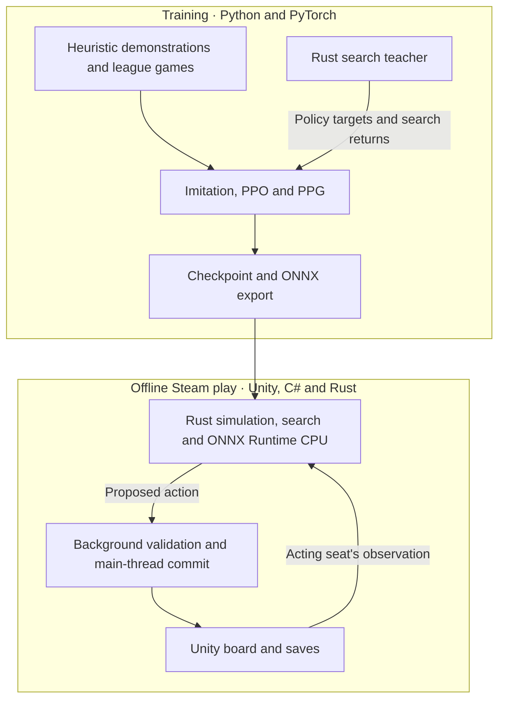

# Brass: Birmingham AI

**Four-player game AI trained through self-play and deployed for offline play in the Windows Steam edition of *Brass: Birmingham*.**

In *Brass: Birmingham*, players plan two-action turns with private hands, shared resources, and changing turn order.
This project connects PyTorch training to a Rust simulator and search engine, with ONNX Runtime for CPU inference and C# integration with the Unity game.

[Try the search demo](#getting-started) · [Architecture](#architecture) · [Training](#training) · [Validation](#validation-summary) · [Local play](#local-play) · [Repository guide](#repository-guide)

## Architecture



- **Search.** Gumbel information-set Monte Carlo tree search (IS-MCTS) samples plausible hidden worlds, uses sequential halving to allocate simulations among root actions, and backs up outcomes for all four seats. Each simulated actor gets its own view, and both actions share one turn budget. [Search implementation](ai-research/RUST_BACKEND_L10_REPORT.md)
- **Model.** The v11.2 network uses grouped state projections and a 512-wide, eight-block residual trunk. It scores variable legal-action sets and predicts win share, placement, victory points, and remaining utility for each seat. Opponent descriptors condition only the critic. [Model design](ai-research/OPPONENT_CRITIC_DESCRIPTORS_REPORT.md)
- **Game integration.** The native worker runs two single-threaded search sessions with in-process inference. Unity validates actions on detached snapshots and rechecks the actor, game revision, and legality before committing on the main thread. [Local backend design](ai-research/RUST_BACKEND_LOCAL_RELEASE.md)

## Training

Heuristic demonstrations initialize the policy, then league self-play mixes the learner with frozen checkpoints and heuristic opponents.
PyTorch uses Proximal Policy Optimization (PPO) for policy updates and Phasic Policy Gradient (PPG) for value fitting.
Rust search teachers supply improved action distributions for distillation and returns for a separate search-value head.
The lab can overlap policy-only rollouts with teacher games, running inference on CPU workers and PyTorch updates on the GPU.
[CPU collection implementation](ai-research/RUST_CPU_INFERENCE_REPORT.md) · [Overlap design](ai-research/RUST_OVERLAP_AND_TRAINING_SPEED_REPORT.md)

Whole-game holdouts monitor value fitting. An optional controller adjusts the teacher loss weight from measured policy and distillation gradient norms.
Resumable checkpoints retain optimizer and random-number generator state, and record replay provenance.
[Adaptive teacher implementation](src/brass_ai/recovery/adaptive_teacher_beta.py) · [Checkpoint recovery guide](docs/STEP5_MACHINE_TRANSFER.md)

Playing strength is tracked in held-out mixed-model games using Plackett–Luce ratings and victory-point summaries.
The **g1760** snapshot fits ratings over **22,528 evaluation games**, with the original g1290 checkpoint as the zero baseline and bootstrap intervals clustered by game setup.
[g1760 report and plots](https://github.com/riverside234/ai-training-results/tree/e1dc6902354b44c75dcccfcb77537ef66805d1a1/joint7-v11-2-g1190-restart-3-g1760-20261112T032005577459Z/ratings/slots/generation-001760) · [Training results archive](https://github.com/riverside234/ai-training-results)

## Validation summary

| Check | Recorded result |
| --- | --- |
| Rules parity | The Rust simulator matched the frozen C# reference across **20 complete games** and **8,344 transitions**, plus **1,406 alternative moves**. [Rules report](ai-research/RUST_BACKEND_L05_REPORT.md) |
| Unity responsiveness | Background validation reduced the median worst-frame interval from **238.6 ms to 122.2 ms (48.8% lower)** in an 80-turn paired comparison on a Windows x64 test machine. [Benchmark methods](ai-research/RUST_BACKEND_L14_REPORT.md) |
| Validation allocations | The validation path allocated **48.4% fewer managed object bytes** in an isolated Mono probe over eight matched actions per arm. [Allocation study](ai-research/RUST_BACKEND_LOCAL_RELEASE.md#l14-allocation-measurement-completed-for-the-validation-stages) |
| Complete-game integration | A four-player game with three neural opponents completed both eras and final scoring with **48 AI search turns** under the four-second search setting. [Release checks](ai-research/RUST_BACKEND_LOCAL_RELEASE.md#l15-complete-normal-clock-games) |

Additional recorded checks cover hidden-information isolation, ONNX output parity, cancellation, save/load, and installation recovery. [Validation and benchmark details](docs/VALIDATION_RESULTS.md)

## Getting started

Run the standalone four-player hidden-information demo with Python 3.10 or newer. The demo and its regression suite use the standard library.

```sh
git clone --depth 1 https://github.com/riverside234/brass-birmingham-ai.git
cd brass-birmingham-ai
python scripts/reproduce-gumbel-is-mcts.py --simulations 128 --seed 7
python -m unittest discover -s tests/GumbelISMCTS -v
```

The demo prints the selected action and the number of simulations completed in each halving round.
The reference also shows how to replay recorded random draws to verify an entire search trace. [Algorithm reference](ai-research/GUMBEL_IS_MCTS_REFERENCE.md)

To verify observation, action, and four-seat value contracts, run the following in a Python virtual environment. [Contract guide](docs/R0_CONTRACTS.md)

```sh
python -m pip install -r requirements-r0.txt
python scripts/verify-r0.py
python -m unittest discover -s tests/R0 -v
```

## Local play

Local matches support per-seat human, V4 heuristic, and neural controllers, including mixed and all-AI tables.
The neural choices are **Alpha Test**, **Beta**, **IL** (imitation learning), and **beta-2**, each tied to a specific checkpoint.
AI seats have independent **4, 8, 10, or 12-second** search settings.
Neural play uses standard four-player rules, and saves record the selected models and per-seat settings.
[Mixed-seat integration](docs/MIXED_AI_GAME_UPDATE.md) · [Neural model registry](src/BrassLocalAI/Native/NativeModel.cs)

The local patch requires a compatible Windows Steam installation and separately built runtime packages. Patched saves need a compatible runtime.
Full training collection uses a verified game runtime.
[Checkpoint packaging and rollback](ai-research/NN_BETA2_G1190_GAME_UPDATE.md#packaging-and-verification) · [Reference-host setup](docs/R1_HOST.md)

## Repository guide

| Location | Purpose |
| --- | --- |
| [native/](native/) | Rust rules adapter, hidden-world sampling, feature encoding, search, and ONNX inference |
| [lab-native/](lab-native/) · [lab-native-cpu/](lab-native-cpu/) | Rust collection and search-teacher workers, including the CPU inference overlay |
| [src/brass_ai/](src/brass_ai/) | PyTorch models, self-play, distillation, evaluation, and checkpoint recovery |
| [src/BrassLocalAI/](src/BrassLocalAI/) · [src/BrassPatch/](src/BrassPatch/) | Unity AI selection and scheduling, action validation, save handling, and game UI |
| [configs/](configs/) · [training/](training/) | Versioned contracts, training recipes, opponent banks, and selected model artifacts |
| [scripts/](scripts/) · [tests/](tests/) | Demos, training entry points, benchmarks, and regression suites |
| [docs/](docs/) · [ai-research/](ai-research/) | Setup guides, design decisions, experiments, and release reports |

## Attribution and distribution

This project is independent of the game's publisher and developers. Proprietary game files are external dependencies.
The repository contains source, selected checkpoints, and written validation reports. Bulk replay, full training state, and detailed local benchmark artifacts live outside the source repository.
[Evidence availability](docs/VALIDATION_RESULTS.md#reproducibility-and-availability) · [Results storage](docs/RESULTS_STORAGE.md)

The project preserves source and license notices for the Daiyu AI rules and learning code, OpenSpiel search, and the Gumbel IS-MCTS references.
[Upstream Rust rules notice](native/vendor/brass-upstream-rules/NOTICE.md) · [Learning notice](src/brass_ai/learning/NOTICE.md) · [OpenSpiel search notice](src/BrassMaskedSearch/NOTICE.md) · [Gumbel IS-MCTS reference](ai-research/GUMBEL_IS_MCTS_REFERENCE.md)
